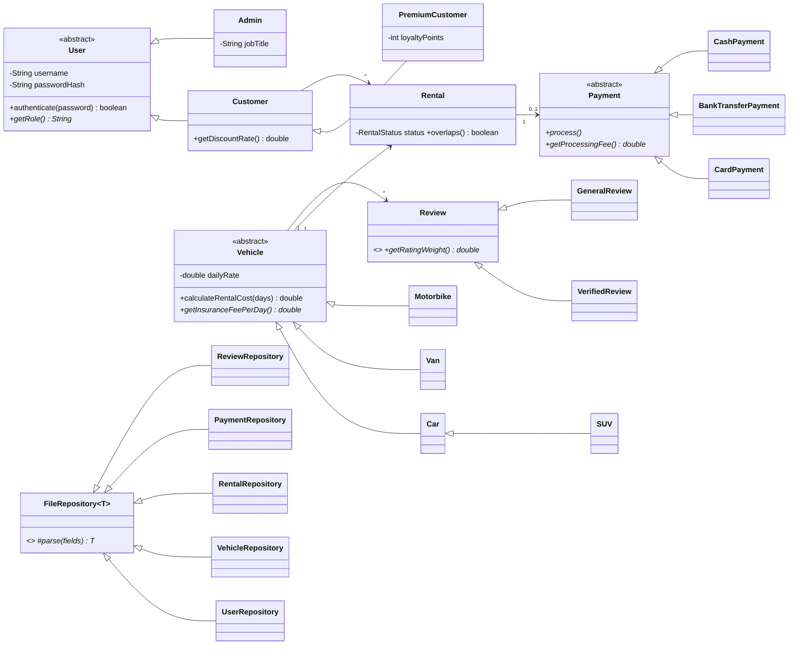

# DriveEasy – Vehicle Rental Service Platform

SE1020 Object Oriented Programming project. A web application for renting cars, SUVs, vans and
motorbikes, built with **Java 17, Spring Boot 3, JSP, Bootstrap 5** and **text-file storage**
(no database).

---

## 1. How to run it

### In IntelliJ IDEA (recommended)
1. **File → Open** and choose the `VehicleRentalPlatform` folder (the one with `pom.xml`).
2. Wait for IntelliJ to finish downloading the Maven libraries (progress bar at the bottom).
3. Make sure a JDK 17 or newer is selected: **File → Project Structure → SDK**.
4. Open `src/main/java/com/driveeasy/rental/RentalApplication.java` and click the green ▶ next to `main`.
5. Open **http://localhost:8081** in your browser.

> If IntelliJ shows JSP pages as 404, open **Run → Edit Configurations**, select
> `RentalApplication` and set **Working directory** to `$MODULE_WORKING_DIR$` (the project folder).

### From a terminal (needs Maven installed)
```bash
mvn spring-boot:run
```

### Port 8081 already in use?
Set another port before running, e.g. add the environment variable `PORT=8082`,
or change `server.port` in `src/main/resources/application.properties`.

### Demo accounts
| Role | Username | Password |
|------|----------|----------|
| Administrator | `admin` | `admin123` |
| Administrator (staff) | `staff` | `staff123` |
| Regular customer | `nimal` | `nimal123` |
| Premium customer | `kasuni` | `kasuni123` |
| Regular customer | `tharindu` | `tharindu123` |

### Resetting the data
All data is in the `data/` folder. Stop the app, delete the `.txt` files and start it again —
fresh sample data is created automatically (see `config/DataInitializer.java`).

---

## 2. Components and CRUD operations

| # | Component | Create | Read | Update | Delete | Data file |
|---|-----------|--------|------|--------|--------|-----------|
| 1 | **User Management** | Register / admin adds user | Login, profile, search users | Edit profile, change password, upgrade to Premium | Delete own account / admin deletes user | `users.txt` |
| 2 | **Vehicle (Fleet) Management** | Admin adds vehicle | Browse, search, filter, view details | Edit details, change status | Remove vehicle | `vehicles.txt` |
| 3 | **Rental (Booking) Management** | Book a vehicle | My bookings, all bookings | Change dates, hand over, mark returned | Cancel booking, delete old record | `rentals.txt` |
| 4 | **Payment Management** | Pay by card / bank / cash | Payment history, receipts | Mark as paid, refund | (removed with its booking record) | `payments.txt` |
| 5 | **Review & Feedback** | Write review | Reviews + average rating per vehicle | Edit own review | Delete own review / admin moderation | `reviews.txt` |
| 6 | **Admin Dashboard** | – | Revenue, fleet and booking statistics | – | – | reads all files |

### Pages (UIs) – 21 in total
* **Public:** Home, Browse vehicles, Vehicle details (with booking form and reviews), About, Login, Register
* **Customer:** My bookings, Change booking, Checkout, Payment history, Receipt, Edit review, My profile
* **Admin:** Dashboard, Fleet list, Add/Edit vehicle, Users list, Add/Edit user, Bookings, Payments, Reviews

---

## 3. Where each OOP concept is used

| Concept | Where to show it in the viva |
|---------|------------------------------|
| **Encapsulation** | Every model class has `private` fields with getters/setters, e.g. `model/vehicle/Vehicle.java`. `Rental` only changes status through `confirm()`, `startTrip()`, `complete()`, `cancel()`. |
| **Information hiding** | `User.passwordHash` has **no getter** – other classes can only call `authenticate()` / `changePassword()`. Passwords are stored as salted SHA‑256 hashes (`util/PasswordUtil.java`). `CardPayment` stores only the last 4 card digits. |
| **Inheritance** | `User → Customer → PremiumCustomer`, `User → Admin` · `Vehicle → Car → SUV`, `Vehicle → Van`, `Vehicle → Motorbike` · `Payment → CardPayment / BankTransferPayment / CashPayment` · `Review → VerifiedReview / GeneralReview` · `FileRepository → UserRepository, VehicleRepository …` |
| **Polymorphism (overriding)** | `Vehicle.calculateRentalCost()` – `Van` adds a cleaning fee, `Motorbike` gives a weekly discount. `getInsuranceFeePerDay()` differs per type. `Customer.getDiscountRate()` – `PremiumCustomer` returns 10%. `Payment.process()` – card is paid immediately, cash/bank stay pending. `Review.getRatingWeight()` – verified reviews count double. `toFileString()` – each class writes its own fields. |
| **Polymorphism (runtime)** | `RentalService.quote()` works with any `Vehicle` and any `Customer` without knowing the subclass. `ReviewService.weightedAverage()` loops over a `List<Review>`. |
| **Abstraction** | Abstract classes `User`, `Vehicle`, `Payment`, `Review`, `FileRepository`. Interfaces `Identifiable`, `FileStorable`, `DataRepository<T>`. |
| **Generics** | `FileRepository<T extends Identifiable & FileStorable>` holds all file logic once for every entity. |

## 4. File handling

* `repository/FileRepository.java` reads files with `BufferedReader(FileReader)` and writes them with
  `BufferedWriter(FileWriter)`. Each record is **one line**, fields separated by `|`.
* Methods are `synchronized` so two requests never write the same file at the same time.
* `util/FileUtil.java` escapes `|`, new lines and `\` inside text so user input can never break a line.
* IDs are generated automatically (`U001`, `V001`, `R001`, `P001`, `RV001`).
* The first field of each line tells the repository **which subclass** to create
  (e.g. `CAR`, `SUV`, `VAN`, `MOTORBIKE`) – then the object handles its own data.

Example lines:
```text
users.txt     PREMIUM|U003|kasuni|<salt:hash>|Kasuni Fernando|kasuni@gmail.com|0719876543|2026-04-06|B7654321|45 Kandy Road|120
vehicles.txt  SUV|V004|Toyota|Land Cruiser Prado|2020|CAR-9090|32000.0|7|Diesel|RENTED||Powerful 4x4 ...|Colombo|Automatic|true
rentals.txt   R002|U003|V004|2026-11-04|2026-11-09|Colombo|ONGOING|166000.0|16600.0|149400.0|2026-10-31
payments.txt  CARD|P002|R002|U003|149400.0|2026-10-31T14:40|PAID|Kasuni Fernando|1881
reviews.txt   VERIFIED|RV001|V001|U002|Nimal Perera|5|Very clean car ...|2026-10-01|R001
```

## 5. Business rules (good to mention in the presentation)
* Price = (daily rate + insurance) × days, then type rules (van cleaning fee, bike weekly discount), then Premium 10% off.
* A vehicle can't be booked for dates that overlap an open booking, or while under maintenance.
* Regular customers can hold 2 open bookings, Premium members 5.
* Bookings can be changed or cancelled before pickup; paid bookings keep the same price.
* Cancelling refunds the payment. Completing a trip gives Premium members loyalty points.
* Vehicles or users with open bookings can't be deleted; the last admin can't be deleted.

## 6. Project structure
```text
src/main/java/com/driveeasy/rental
├── RentalApplication.java      Main class
├── config/                     Login check, sample data, error handling
├── controller/                 Customer pages (URLs → JSP)
│   └── admin/                  Admin pages
├── dto/                        Form objects
├── exception/                  BusinessException, ResourceNotFoundException
├── model/                      OOP classes (user, vehicle, rental, payment, review)
├── repository/                 File handling (one repository per .txt file)
├── service/                    Business rules
└── util/                       FileUtil, PasswordUtil, ValidationUtil, SessionUtil
src/main/webapp
├── WEB-INF/jsp/                JSP pages
├── WEB-INF/tags/               Reusable JSP tags (stars, money, vehicle image)
├── css/ js/ images/
data/                           users.txt, vehicles.txt, rentals.txt, payments.txt, reviews.txt
docs/class-diagram.puml         Full class diagram (PlantUML)
```

## 7. Class diagram

The full diagram is in [`docs/class-diagram.puml`](docs/class-diagram.puml) (open it with the
**PlantUML Integration** plugin in IntelliJ, or paste it into plantuml.com to export a PNG for the report).
Summary:



## 8. Tests
`src/test/java/.../OopConceptsTest.java` checks pricing polymorphism, Premium discounts, payment
processing, file escaping and password hashing. Run it from IntelliJ (right-click → Run) or `mvn test`.
